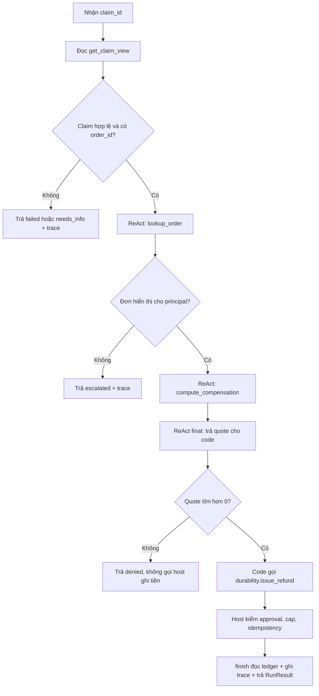

# Jay — Single ReAct, Crash Recovery & Research Implementation Plan

> **For agentic workers:** Dùng skill `executing-plans` khi được yêu cầu triển khai tài liệu này. Làm lần lượt từng task, viết test trước và ghi kết quả thực tế. Đây là spec/hướng dẫn; chưa phải bằng chứng code đã chạy.

**Goal:** Hoàn thành đúng phần Trần Gia Bảo (Jay, MSSV 2A202603914): Shape B, test riêng, bằng chứng crash, research card và phần báo cáo tương ứng.

**Architecture:** Một vòng ReAct chọn công cụ chỉ đọc, tối đa 8 lượt. Công cụ Python tính quote; sau vòng lặp, shape gọi host để kiểm approval và ghi refund. Ledger và audit trong transaction đảm bảo retry không tạo thêm lần hoàn tiền.

**Tech Stack:** Python 3.11–3.13, SQLite, pytest, MockLLM có sẵn. Không cần model thật, API key, framework agent mới hoặc dependency mới.

**Spec:** Chính tài liệu này; nguồn yêu cầu là `TEAM.md:63–80`, `notes/07_TEAM_WORK_BREAKDOWN_3_MEMBERS.md:91–107`, `docs/contracts.md`, `docs/business_rules.md`, `RULES.md`, `src/README.md`. Nếu thiết kế đề xuất dưới đây khác luật chấm, ưu tiên luật chấm.

## 1. Jay thực sự đang xây cái gì?

Bạn xây một nhân viên tiếp nhận yêu cầu hoàn phí: đọc claim, tra đúng đơn của khách, lấy mức bồi hoàn bằng code, rồi gửi đề xuất tới bộ phận duyệt tiền (host).

- **Claim:** yêu cầu của khách; `ticket` là lời khách viết, có thể sai hoặc chứa lệnh giả.
- **Principal:** danh tính người yêu cầu; chỉ được xem đơn thuộc người đó.
- **Quote / proposal:** mức được hưởng theo đơn và policy hiện hành.
- **Approval:** quyền hoàn tiền host kiểm; agent không tự tạo hay bỏ qua.
- **Effect / ledger:** tiền thực tế đã ghi. Có thể thấp hơn proposal.
- **Idempotency:** cùng yêu cầu chạy lại vẫn chỉ một refund.
- **Checkpoint:** ghi đã đi đến bước nào; riêng checkpoint không chứng minh tiền chưa được trả.
- **Trace:** nhật ký có cấu trúc để chấm và kiểm tra rò dữ liệu.

Ví dụ: entitlement 150.000đ, đơn đã được claim khác hoàn 30.000đ. Single đề xuất **150.000đ**, host ghi **120.000đ**. Nếu Single tự trừ còn 120.000đ trước khi gọi host, host có thể trừ thêm lần nữa và làm sai bài.



## 2. Phạm vi file và phối hợp nhóm

| File | Việc của Jay |
| --- | --- |
| `src/lab8/shapes/single.py` | Thay stub bằng implementation Shape B; giữ signature |
| `src/tests/test_member2_single_and_crash.py` | Tạo test chức năng, giới hạn, bảo mật, retry và crash |
| `src/reports/crash.json` | Sinh bằng CLI crash suite, không viết tay |
| `src/reports/jay_single_benchmark.json` | Đề xuất: report riêng Single để kiểm trước khi tích hợp |
| `src/bonus/jay_ablation.py` | Đề xuất: script thí nghiệm tái lập cho research card; không tự nhận là đã đạt bonus |
| `src/reports/jay_ablation.json` | Sinh từ script thí nghiệm, không viết tay |
| `report/team/research_card.md` | Điền nguồn thật, hypothesis, phương pháp và kết quả thật |
| `report/team/2A202603914_TranGiaBao.md` | Ghi đóng góp, commit thật, test/output thật, giới hạn |
| `report/team/group_report.md` | Chỉ bổ sung phần Shape B tại mục 3, bằng chứng liên quan nếu nhóm phân công |
| `TEAM.md` | Chỉ cập nhật dòng và phần đóng góp của Jay bằng dữ kiện thật |

Không làm thay workflow/orchestrator. Benchmark tổng bốn shape và ADR do Hà Anh phụ trách; Jay bàn giao số liệu Single và crash. Khi sửa file báo cáo chung, đọc phiên bản mới nhất và giữ nguyên phần người khác.

### Global Constraints

- Không đổi `run_claim(claim_id: str, *, seed: int, store_path: str, crash_at: str | None = None) -> RunResult`.
- Mọi lệnh lab chạy từ `src/` trong môi trường Python phù hợp.
- Không sửa host, runtime, tools, compensation, handoff, MockLLM, swarm, metrics, config, dữ liệu, test gốc hay cấu hình pytest để làm test xanh.
- Implementation Single phải tự chứa trong `single.py` và chỉ dùng module có sẵn: grader hidden chỉ nhận shape và `bonus/`, không nhận helper mới đặt tùy ý.
- Không đọc nhãn `expected`, hardcode kết quả theo claim ID/seed, truy vấn DB để vượt API công cụ, hoặc sao chép `REFERENCE_WEAKNESS` của swarm.
- Không commit SQLite, traces, virtualenv, secrets. Không tự tạo commit dưới danh tính người khác.
- Không ghi “passed”, run ID dẫn chứng, commit hoặc mức hoàn thành khi chưa có bằng chứng thực tế.

## 3. Contract chức năng của Single

### 3.1 Khởi tạo và kết thúc

1. Mở `conn = connect(store_path)`; `finally: conn.close()` phải chạy cả khi crash.
2. Tạo `Budget()`, `Trace(make_run_id("single", claim_id, seed))`.
3. Đọc claim bằng `get_claim_view`; nếu gọi trực tiếp ngoài dispatch, cộng `budget.add_tool(tool_cost())` đúng một lần.
4. Mọi đường trả kết quả bình thường dùng `finish(...)`, với `shape="single"`, đúng `claim_id`, `seed`, budget và trace.
5. `finish` tự đọc refund/audit từ DB; không tự bịa `refund_effects` hay `committed_audit_count`.

### 3.2 Các nhánh kết quả bắt buộc

| Điều kiện | Status | proposal_amount | Gọi issue_refund? |
| --- | --- | --- | --- |
| Claim không tồn tại | `failed`, reason `unknown_claim` | 0 | Không |
| Thiếu order_id | `needs_info` | 0 | Không; không trích order_id từ ticket |
| Không có đơn hoặc sai chủ sở hữu | `escalated` | 0 | Không |
| Quote bằng 0 | `denied` | 0 | Không |
| Quote > 0, host từ chối | `denied` | Full quote | Có, để host ghi `policy_denied` |
| Quote > 0, host chấp nhận | `resolved` | Full quote | Có |
| Host trả conflict | `failed` | Full quote | Có; giữ refund cũ |
| ReAct hết giới hạn mà chưa final | `failed`, reason `step_cap` | 0 | Không |

Không tự kiểm approval rồi return trước host khi quote > 0: như vậy thiếu audit bắt buộc. Số tiền thực tế lấy từ ledger, không dùng proposal để đoán effect.

### 3.3 ReAct và MockLLM: thiết kế đề xuất

Gọi đúng API:

```python
run_react(
    conn, budget,
    observation={"claim": claim},
    decide=decide,
    max_steps=8,
    worker=True,
)
```

`decide` trả action dict cho runtime; runtime mới dispatch tool. Không gọi tool ghi tiền trong `decide` hoặc đọc/ghi SQL từ callback.

| Lượt thông thường | Dữ liệu nhận | Action trả về |
| --- | --- | --- |
| 1 | Claim ban đầu | `{"tool": "lookup_order", "args": {"order_id": ..., "principal_id": ...}}` |
| 2 | `last_tool=lookup_order`, `last_result=order_view` | Nếu không visible: final escalated. Nếu visible: action compute_compensation, truyền order từ tool |
| 3 | `last_tool=compute_compensation`, `last_result=quote_payload` | `{"final": {"status": "done", "quote": quote_payload}}` |

`done` chỉ là trạng thái **nội bộ** của vòng lặp; không đưa vào `RunResult` vì không nằm trong enum hợp lệ.

Giữ `order_view`, `quote_payload`, số lượt trong biến cục bộ/closure của **mỗi lần run**, không dùng trạng thái toàn cục. Runtime chỉ giữ kết quả tool gần nhất; không giả định observation chứa toàn bộ lịch sử.

Trong mỗi lượt `decide`, gọi `complete(budget, seed=seed, purpose="decide", prompt=...)` một lần, với prompt ngắn chỉ chứa phase và dữ kiện an toàn cần thiết. Hàm này tự cộng model_calls/tokens/cost; không cộng thêm lần nữa. Tool do dispatch gọi cũng tự cộng budget.

**Giới hạn mô phỏng:** MockLLM không trả JSON tool-call thực. Vì vậy callback Python chọn action từ trạng thái quan sát; chuỗi MockLLM thể hiện lời gọi và usage mô phỏng. Phải mô tả trung thực đây là vòng ReAct có điều khiển bằng code trong lab, không khẳng định đã xây agent lập kế hoạch bằng LLM thật. Không parse chuỗi `decide:<digest>` thành một action tưởng tượng.

Sau khi có status cuối, thiết kế đề xuất gọi thêm đúng một `complete(..., purpose="draft", prompt=<status>)` để mô phỏng soạn lời trả lời. Nội dung draft không quyết status/quote và không cần ghi vào RunResult. Lời gọi này tạo biến có thể bật/tắt trong ablation.

**Ba số khác nhau:** tối đa 8 lượt `decide`; `model_calls` còn có thể gồm lượt draft ngoài loop; metric `steps` của benchmark là số event trace. Không kiểm `model_calls <= 8` hay `len(trace.events) <= 8` để thay cho kiểm giới hạn ReAct.

### 3.4 Tiền, crash và ngoại lệ

```python
# Sau khi vòng lặp dừng và code đã lấy full quote:
outcome = issue_refund(conn, claim_id, proposal, crash_at=crash_at)
status = "resolved" if outcome["ok"] else (
    "failed" if outcome["conflict"] else "denied"
)
```

Không tự trừ lịch sử refund, tự tạo approval, ghi ledger, hoặc quyết quote từ ticket/MockLLM. `compute_compensation` đã dùng policy hiện hành; không cần tool dư chỉ để tăng số lượt.

`InjectedCrash` phải được ném ra ngoài để test nhận diện crash thật. Có thể bắt riêng để ghi event an toàn rồi **raise lại**; không biến crash thành `RunResult`. Đây là ngoại lệ có chủ đích đối với yêu cầu không phát sinh exception trong lượt bình thường. Không bọc toàn bộ bằng `except Exception: denied` vì vừa che lỗi vừa nuốt crash.

Nếu tool/runtime phát sinh lỗi dự kiến như ToolRejected, trả failed với mã lỗi an toàn, không hoàn tiền và không dump exception chứa dữ liệu thô. Lỗi lập trình phải được phát hiện bằng test, không được âm thầm coi là một quyết định nghiệp vụ.

### 3.5 Trace và bảo mật

- Ghi event cho claim-read, quyết định/action từng lượt, kết quả tool bằng allowlist, host outcome và final decision.
- Có thể ghi claim_id, tool name, visibility, amount, clause_ids, status, reason an toàn.
- Không log nguyên ticket, raw prompt, toàn bộ observation, SELECT * row, header, parent_secret, phone, address, item, internal note hay exception tùy ý.
- `get_claim_view` bỏ secret cấu trúc nhưng vẫn chứa ticket tự do: không có nghĩa là toàn bộ claim view an toàn để log.
- Không cần xuất reasoning dài của model; ghi action và dữ kiện đủ audit.
- Mọi return bình thường có trace mới ghi trong lượt đó, JSON chứa run_id đúng và events dạng list.

## 4. Test nghiệm thu của Jay

### Review Focus

1. Early return cũng có trace hợp lệ và không có effect mới.
2. Ownership/approval bị từ chối không bị agent vượt qua; quote dương vẫn đi qua host để có audit.
3. Ticket độc hại hoặc nói dối không thay đổi số tiền; không xuất hiện nguyên văn trong trace.
4. Retry/crash dùng lại cùng DB, còn trial benchmark độc lập phải có DB mới.
5. Trần 8 lượt thực sự được truyền vào runtime; số event và model_calls không phải số lượt loop.

> Dòng 4 ở checklist trên có nghĩa: luôn dùng cùng DB cho retry/resume; không tạo DB mới giữa hai lần rồi kết luận chống trùng thành công.

### Task 1 — Happy path, early returns và tiền

**Files:** sửa `single.py`; tạo `tests/test_member2_single_and_crash.py`.

- [ ] Viết test C-001 trước, chạy thấy stub thất bại, rồi mới triển khai.
- [ ] Dùng fixture `public_db` từ conftest; test tự tạo dữ liệu trong DB tạm, không sửa fixture gốc.
- [ ] Thêm test cho các nhánh trong bảng contract; dùng `BY_ID[claim_id]["expected"]` chỉ trong test, không trong implementation.
- [ ] C-002 với seed 55 vẫn phải denied vì order trễ 2 ngày; C-014 proposal 150000 nhưng effect 120000; C-013 denied và có policy_denied.
- [ ] Khi quote 0, spy/monkeypatch ở vị trí symbol được `single.py` sử dụng để xác minh không gọi issue_refund.

Ví dụ test tối thiểu có thể chạy trực tiếp:

```python
from lab8.shapes.single import run_claim

def test_single_happy_path(public_db):
    result = run_claim("C-001", seed=11, store_path=str(public_db))
    assert result.shape == "single"
    assert result.status == "resolved"
    assert result.proposal_amount == 35000
    assert len(result.refund_effects) == 1
    assert result.refund_effects[0]["amount_vnd"] == 35000
    assert result.committed_audit_count == 1
```

### Task 2 — ReAct, budget và trace

- [ ] Spy `run_react` tại vị trí Single gọi: assert worker=True, max_steps=8, không thay bằng hàm giả trả luôn thành công.
- [ ] Spy callback decide và dispatch thực: đếm lượt, chỉ thấy tool đọc; assertion cấm issue_refund trong lúc callback đang chạy.
- [ ] Kiểm runtime thật với decide luôn chọn read tool: sau đúng 8 lượt trả stopped=step_cap. Đồng thời kiểm Single xử lý kết quả step_cap bằng failed, không gọi host ghi tiền.
- [ ] Test budget: số tool/model thực gọi khớp counters; không hardcode giá tiền, không đếm hai lần dispatch/complete.
- [ ] T09 kiểm injection, T10 kiểm secret; mọi nhánh early return kiểm file trace, run_id, events. Test stdout cũng không chứa dữ liệu cấm.
- [ ] Không đánh dấu các test riêng là student nếu muốn chúng chạy trong cổng mặc định.

### Task 3 — Idempotency và crash/resume qua Single

Ví dụ retry:

```python
def test_single_retry(public_db):
    first = run_claim("C-011", seed=11, store_path=str(public_db))
    second = run_claim("C-011", seed=11, store_path=str(public_db))
    assert first.status == second.status == "resolved"
    assert first.refund_effects == second.refund_effects
    assert len(second.refund_effects) == 1
    assert second.committed_audit_count == 1
```

Ví dụ crash:

```python
import pytest
from lab8.db import connect
from lab8.durability import InjectedCrash, get_refund, committed_audit_count

@pytest.mark.parametrize("point", [
    "before_effect", "after_effect_before_checkpoint", "after_checkpoint",
])
def test_single_crash_resume(public_db, point):
    with pytest.raises(InjectedCrash):
        run_claim("C-012", seed=11, store_path=str(public_db), crash_at=point)
    conn = connect(public_db)
    try:
        before = get_refund(conn, "C-012")
        assert (before is None) == (point == "before_effect")
    finally:
        conn.close()
    result = run_claim("C-012", seed=11, store_path=str(public_db))
    assert result.status == "resolved"
    conn = connect(public_db)
    try:
        count = conn.execute(
            "SELECT COUNT(*) FROM refund_ledger WHERE claim_id = ?", ("C-012",)
        ).fetchone()[0]
        assert count == 1
        assert committed_audit_count(conn, "C-012") == 1
    finally:
        conn.close()
```

- [ ] Thêm assert số tiền đúng theo expected và trace hợp lệ sau resume.
- [ ] Chạy crash suite chính để tạo crash.json; suite này kiểm host + swarm, **không thay thế** test Single ở trên.
- [ ] Giải thích được: after_effect_before_checkpoint đã commit tiền + audit, chỉ checkpoint chưa ghi; retry phải nhìn ledger và không trả thêm tiền.

## 5. Lệnh kiểm chứng và ý nghĩa

Các lệnh dưới đây là hướng dẫn cho lượt triển khai, **chưa được chạy khi soạn spec**. Dùng Python của venv đã cài requirements. Nếu chưa có môi trường, cài theo `src/README.md`; không tự đổi Python hệ thống.

Chuyển vào thư mục:

```bash
cd /home/jay/Desktop/AI20k/K5-L3B-DAY08-ConBoBietIuu-FromWorkflowsToAgents/src
```

Chạy theo thứ tự:

```bash
python -m lab8.smoke
python -m pytest -q tests/test_member2_single_and_crash.py
python -m pytest -q tests/test_public_matrix.py -m student -o addopts= -k single
python -m pytest -q
python -m lab8.crash_test --count 20 --out reports/crash.json
python -m lab8.benchmark --shapes single --cases data/public_claims.jsonl --seeds 11,22,33,44,55 --out reports/jay_single_benchmark.json
```

Kết quả mục tiêu, không phải kết quả đã xác minh:

- Smoke pass; test Jay pass; host gate không có regression.
- File public_matrix chọn Single: 62 test pass = 12 claim × 5 seed + 1 retry + 1 crash. Không gọi đây là “62 test trên 5 seed” cho tất cả tình huống.
- Crash suite: crash_safety 20/20.
- Benchmark Single: 14 claim × 5 seed = 70 trial, mục tiêu pass_rate=1 và pass_5=1 trên public. Benchmark không thay thế kịch bản multi-run T11/T12 của pytest.
- Giá là mô phỏng VND; latency unavailable. Không suy ra đã đạt hidden 0.75 từ public xanh.

Sau khi cả nhóm tích hợp, chạy toàn bộ student matrix và benchmark 4 shape theo README; Hà Anh ghi số liệu vào ADR. `check_submission` có thể còn fail do phần nhóm khác chưa xong: báo rõ blocker, không sửa giả hồ sơ để vượt checker.

## 6. Task 4 — Research card và một ablation có kiểm soát

**Đề xuất cụ thể:** chọn R4, khảo sát ảnh hưởng của bước soạn câu trả lời `draft` đến cost/success. Đây là thí nghiệm thành phần trong Single; không dùng nó để tuyên bố topology multi-agent tốt/xấu hơn.

**Câu hỏi dễ hiểu:** Sau khi đã biết hoàn hay từ chối và số tiền bao nhiêu, gọi thêm model để viết lời trả lời có làm quyết định đúng hơn hay chỉ tăng chi phí mô phỏng?

- Baseline: Single với các lượt decide và một draft cuối như mục 3.3.
- Treatment: giữ nguyên code Single, mọi lượt decide và công cụ; chỉ bỏ lời gọi purpose=draft.
- Giữ cố định corpus public, seeds 11/22/33/44/55, MockLLM, prompt các lượt còn lại, policy, giá, evaluator, DB mới mỗi trial.
- Hypothesis trước khi chạy: pass_rate/pass_5 và effect không đổi; model_calls giảm một trên mỗi lượt hoàn thành có draft; cost/success giảm. Không đoán một con số VND khi chưa chạy.
- Script đề xuất `bonus/jay_ablation.py` gọi `run_benchmark` hai lần với shapes=["single"] và cùng dữ liệu; trong treatment, dùng patch có phạm vi để chỉ chặn `single.complete` khi purpose=draft. Mọi purpose khác gọi hàm gốc, không chỉnh counters bằng tay. Yêu cầu Single import complete trực tiếp ở module scope để vị trí patch rõ ràng.
- Chạy hai arm tuần tự và phục hồi patch khi xong. Không dùng treatment thay thế Single chính thức khi chấm.
- Xuất JSON bằng script gồm hai report gốc, biến thay đổi, config/seed, delta metric và kiểm tra kết quả nghiệp vụ. Muốn so effect chi tiết, chạy paired assertions trên DB tạm cho từng claim/seed; run_benchmark summary không chứa toàn bộ effect.
- Nếu giữ trace làm bằng chứng cho cả hai arm, sao chép traces sau mỗi arm vào thư mục traces riêng, tránh arm sau ghi đè run_id giống nhau. Không đưa traces vào Git.
- Thêm test script chứng minh chỉ draft bị bỏ, các lượt decide còn nguyên, không sửa trạng thái/quote/ledger; không kiểm cost bằng cách bịa JSON.

CLI do script mới phải hỗ trợ:

```bash
python -m bonus.jay_ablation --cases data/public_claims.jsonl --world data/public_world_state.json --seeds 11,22,33,44,55 --out reports/jay_ablation.json
```

Research card phải điền đủ CÂU, SOURCE, CLAIM, BOUNDARY, HYPOTHESIS, METHOD, FAILURE/METRIC và kết quả ablation. Trước khi điền SOURCE, tra cứu nguồn gốc đáng tin và đọc thực tế; không coi tên paper gợi ý trong starter là đã được xác minh. Nếu nguồn không hỗ trợ kết luận, đổi nguồn hoặc thu hẹp phát biểu. Ghi giới hạn: MockLLM và câu trả lời không được grader chấm, nên thí nghiệm không chứng minh bỏ lời trả lời là tốt trong sản phẩm thật.

## 7. Task 5 — Báo cáo và bàn giao

- [ ] Sửa báo cáo cá nhân: các dòng đang khẳng định đã pass/hoàn thành phải được thay bằng trạng thái đúng trước khi thực nghiệm; sau đó cập nhật bằng output thực tế.
- [ ] Giải pháp Shape B trong báo cáo nhóm: trình bày loop, nguồn quote, quyền host, retry, trace, usage; nói rõ mức độ mô phỏng MockLLM.
- [ ] Điền công cụ AI thực dùng và cách Jay tự xác minh. Không liệt kê Claude/Gemini/ChatGPT nếu không thực dùng đủ các công cụ đó.
- [ ] TEAM: cập nhật file test có thật và commit kỹ thuật thực của Jay. Không tạo commit rồi gán công cho người khác.
- [ ] Bàn giao cho Hà Anh report Single, crash.json, câu lệnh tái lập, run_id thật và các giới hạn; bàn giao cho nhóm trưởng danh sách file thay đổi và output test.
- [ ] Không tự hoàn thiện ADR cho cả nhóm, không điền hash giả, không push/commit khi chưa được giao thực hiện Git.

### Definition of Done — phần Jay

1. single.py không còn stub, đúng contract và chỉ dùng API có sẵn.
2. Test riêng pass; 62 test public Single pass; host gate pass.
3. Test Single thật sự crash ở ba vị trí và resume không trả tiền lần hai.
4. crash.json được CLI sinh và đạt 20/20; hiểu phạm vi host/swarm của report này.
5. Có số liệu public Single, không bypass approval, không lộ dữ liệu cấm.
6. Research card có nguồn xác minh, ablation tái lập và kết quả thật.
7. Báo cáo cá nhân, phần Shape B và đóng góp khớp code/test/commit hiện có.
8. Nếu các phần nhóm khác còn thiếu, báo riêng; không coi đó là lý do bịa bằng chứng hoặc sửa thước đo.

## 8. Jay cần tự trả lời được

1. **Vì sao ticket nói trễ 9 ngày vẫn có thể denied?** Vì dữ liệu đơn và policy hiện hành mới quyết entitlement; ticket không có quyền sửa chúng.
2. **Agent có quyền hoàn tiền không?** Agent chọn công cụ đọc; code ngoài loop gọi host, host mới kiểm quyền và ghi.
3. **Vì sao đề xuất 150.000đ nhưng ledger 120.000đ?** Đơn đã được hoàn 30.000đ; host trừ lịch sử theo đơn.
4. **Vì sao checkpoint không đủ chống trả trùng?** Tiền có thể đã commit trước lúc checkpoint ghi; ledger có khóa idempotency và audit cùng transaction mới là bằng chứng effect.
5. **Vì sao không catch crash rồi return failed?** Test cần thấy crash thật; nuốt nó khiến chưa kiểm được cửa sổ lỗi.
6. **Vì sao giới hạn 8 bước?** Chặn loop vô hạn và chi phí không kiểm soát. Số lượt loop khác số model call và event trace.
7. **Vì sao pytest xanh vẫn có thể chưa làm xong?** Mặc định loại marker student; phải chạy riêng ma trận Single.
8. **Đã dùng LLM thật chưa?** Chưa; lab dùng MockLLM, usage/cost mô phỏng, callback chọn action bằng code.

## 9. Prompt giao việc cho AI

```text
Repo: /home/jay/Desktop/AI20k/K5-L3B-DAY08-ConBoBietIuu-FromWorkflowsToAgents
Đọc docs/superpowers/plans/2026-11-17-jay-single-spec.md và AGENTS.md áp dụng.
Thực hiện đúng phần Jay/Gia Bảo trong spec, lần lượt Task 1–5.
Đọc contract/API hiện có trước khi sửa; test trước, implementation sau.
Không sửa host/runtime/metrics/config/data/test gốc và không làm thay shape khác.
Mỗi bước giải thích ngắn để tôi hiểu: đang làm gì, vì sao, cách kiểm chứng.
Chỉ dùng shell theo phạm vi tôi đã cho phép; nếu chưa được phép thực thi test/cài môi trường,
nêu đúng lệnh cần chạy và xin mở rộng phạm vi trước hành động đó.
Không tự commit/push. Không bịa output, hash, run_id hay mức hoàn thành.
Sau mỗi task báo file thay đổi, kết quả thực tế và blocker.
Khi xong giải thích lại luồng C-001, C-002, C-014 và crash/resume C-012 bằng lời dễ hiểu.
```
